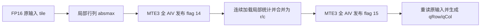

<!-- Copyright 2026 The xLLM Authors. SPDX-License-Identifier: Apache-2.0 -->
# 需求背景（required）

## 需求来源

本设计对应[【xLLM】【2026年10月社区任务】行列双向 INT8 量化算子开发](https://www.hiascend.com/activities/task-center/details/3d5589585db24b20ac613479f66681b8?menu=trends)，按[社区设计模板](https://gitcode.com/cann/cann-ops-competitions/blob/master/04_tasks/01_community-task-2026/resources/design_template.md)组织。

目标代码仓为 [xLLM-AI/xllm](https://github.com/xLLM-AI/xllm)，开发 fork 为 [hbswcsyzx/xllm](https://github.com/hbswcsyzx/xllm)，分支为 `RowColInt8Quant/910/dev`，算子目录为 `xllm/core/kernels/npu/xllm_ops/row_col_int8_quant`。远端开发分支仅提交源码、构建脚本、设计文档和测试代码。验收报告、原始日志、安装包、预编译二进制及材料 ZIP 在本地单独交付，不提交到代码分支。最终验收固定 commit、源码与安装包指纹、逐项自验证结果以本地交付的 manifest 为准。

## 背景介绍

### 行列双向量化的功能

同一连续 FP16 矩阵需要分别按整行、整列的绝对最大值量化，输出两份保持行主序的 INT8 矩阵和两组 FP32 绝对最大值。统计输出是 absmax，不能用反量化 scale 代替。任务仅包含稠密前向路径，不包含 threshold、稀疏异常值输出或反向计算。

### 现有基线与优化动机

任务提供两类基线：FP32 Abs/ReduceMax/Round/Cast 组合，以及两次 DynamicQuant、转置和独立 absmax 的组合。二者均须先通过同一精度规则，才能参与逐用例的同机比较。融合实现直接生成行主序 qRow、qCol，避免完整矩阵转置和完整 FP32 中间矩阵。

归约为绝对值最大值，量化为向量逐元素运算，计算单元选择 AIV。按几何形状划分少量算法域：较小高度采用独立行列所有权，较大高度采用二维分块和局部统计合并。分派依据是形状与依赖成本，不依据用例名称、编号或精确样本形状。

# 需求分析（required）

## 需求描述

输入为单个同设备、连续 ND FP16 张量 `x[M,N]`，元素均有限；`1<=M<=4096`，`2<=N<=4096`，N 必须为偶数，无算子属性。输出按顺序为：

| 输出 | 形状 | 类型 | 布局与所有权 |
| --- | --- | --- | --- |
| qRow | `[M,N]` | INT8 | ND 连续、行主序、新独立存储 |
| qCol | `[M,N]` | INT8 | ND 连续、行主序、新独立存储 |
| rowAbsmax | `[M]` | FP32 | 连续、新独立存储 |
| colAbsmax | `[N]` | FP32 | 连续、新独立存储 |

四个输出的底层存储互不相同，且均不与输入存储重叠。每次正式调用创建新输出，不修改输入，使用调用方当前 NPU stream，计算与数据搬运在 NPU 执行。

## 需求拆解

1. 实现上述完整合法形状域及数值语义。五个性能输入不代表功能支持范围可以缩小。
2. 提供 OpDef、shape/dtype 推导、tiling、Ascend C Kernel、两阶段 ACLNN API、可私有安装的 `.run` 包和独立 C++ 样例。
3. 提供 `prepare`、正式 ACLNN `run` 和独立 `run_direct`。对输入数量、属性容器/未知属性、设备、dtype、rank、连续性和尺寸错误同步报错。
4. 覆盖 27 个公开精度输入、12 个规定的额外种子/存储偏移输入、13 类非法场景及规定的 stream、生命周期、内存与验证器检查。五个 `performance=true` 输入另用于固定耗时和内存验收。
5. 以完整 `run` 的正式墙钟边界优化；保存全部轮次、合格基线、真实环境及源码/产物指纹。

# 详细设计（required）

## 算子分析

### 数学公式

先精确提升输入 `a[i,j]=fp32(x[i,j])`，计算：

```text
r[i] = max( abs(a[i,j]) : 0 <= j < N )
c[j] = max( abs(a[i,j]) : 0 <= i < M )
scale(s) = fp32(127 / max(s, 2^-24))
qRow[i,j] = int8(clip(rint(fp32(a[i,j] * scale(r[i]))), -127, 127))
qCol[i,j] = int8(clip(rint(fp32(a[i,j] * scale(c[j]))), -127, 127))
```

`rint` 为最近偶数舍入。任何非零有限 FP16 绝对值均不小于 `2^-24`，因此保护分母不改变非零轴的缩放；零轴的输入全为零，量化结果仍全零。absmax 本身不经过该保护操作，按原始归约结果写出。

FP16 到 FP32 的提升以及有限值的 abs/max 可精确表达输入幅度，保留次正规数语义；绝对值把正负零统一为正零。量化前的除法与乘法均使用 FP32 向量操作。缩放值先用 `vconv_f322s32r` 舍入为 int32，再经能精确表示 `[-127,127]` 整数的 FP32、FP16 窄化到 INT8；不能先把未舍入缩放值转成 FP16。实现将限幅放在整数舍入前，对有限输入的最终饱和值与定义等价。

### 支持数据类型与形状

仅支持任务定义的 FP16 输入和 INT8/FP32 输出，不通过 BF16、FP32 输入或非连续布局回退到其他实现。FP32 absmax 必须逐位一致；量化差异按官方半整数邻域规则检查。NaN/Inf 不属于本题输入域。

## 算子实现

### 3.2.1 Host 侧设计

#### 接口与校验

ACLNN 工程导出的两阶段接口为：

```cpp
aclnnStatus aclnnRowColInt8QuantGetWorkspaceSize(
    const aclTensor *x, const aclTensor *qRowOut, const aclTensor *qColOut,
    const aclTensor *rowAbsmaxOut, const aclTensor *colAbsmaxOut,
    uint64_t *workspaceSize, aclOpExecutor **executor);

aclnnStatus aclnnRowColInt8Quant(
    void *workspace, uint64_t workspaceSize,
    aclOpExecutor *executor, aclrtStream stream);
```

Host 校验元数据，推导 `[M,N]`、`[M]`、`[N]` 输出并生成 tiling。C++ 调用方负责有效设备指针、正确 ND 描述和不重叠输出存储。Python 入口为 `run([x], {})`；`prepare` 校验并预热运行时缓存，不保留结果；`run_direct` 使用同一个 tiling 数据类进行独立参数构造和二进制直调。

#### 分核与 tiling key

设实际平台 AIV 数为 `A`，启动核数为：

```text
B = min(A, max(M, ceil(N/64)))
row_pad = 最小的、不小于 max(64,N) 的 2 的幂
mt = ceil(M/64), nt = ceil(N/256)
```

| Tiling key | 算法域 | 单个编译入口中的计算顺序 | 用户/系统 workspace |
| --- | --- | --- | --- |
| 0 | `M<512` | 独立行批处理，再执行独立列分块归约和量化 | 0 |
| 1 | `M>=512` | 二维局部统计、统计合并、二维量化 | `16 MiB + 4*mt*nt*320` 字节 |

Host 仅选择一次 key。Kernel 以 `if constexpr (TILING_KEY_IS(...))` 编译为独立入口，每个入口只有一套计算路径；循环界、有效 DMA 长度与零填充处理尾部，不增加运行时算法路由或按输入数值的计算分支。`M=512` 边界两侧另以 511/512/513 高度和 256/1026/4096 宽度作诊断验证，这些附加点不替代官方输入。

Key 1 获取运行时 hardware synchronization address，设置 schedule mode 1；`B<=A`，所有参与发布的 AIV 均能驻留。核数来自实际设备，不能写死为材料中的 48，也不能跨架构复用二进制。

#### 当前 stream、分配与生命周期

正式 `run` 在当前 NPU stream 上创建四个输出。ACLNN 提交通过当前 torch_npu 的 `OpCommand::RunOpApiV3` 入队，显式传入该 framework stream；回调保留输入与 workspace 到提交阶段，输出地址按值传入。输出本身由调用方持有，同 stream 分配器复用遵循已入队操作顺序；保留的多组输出仍各自占有独立存储。输入使用 `recordStream` 保护提前释放与跨 stream 压力场景。

对齐输入的首个 `(device,stream,M,N)` 调用创建描述与 executor，并通过当前 CANN 的 repeatable-executor API 标记可重用；后续调用更新输入和四个新输出地址，再启动计算。缓存仅保存元数据、不保存 Torch 输出或计算结果，按队列线程限制为最多 64 个 plan。非 32 字节对齐的 offset 输入使用新描述与新 executor，避免违反地址更新的对齐约束。每次调用仍分配新输出、执行内核，并核对实际 ACLNN 查询的 workspace 大小。

直调入口使用 `aclrtLaunchKernelWithHostArgs`，提供编译 wrapper 的 hardware-sync 前导参数、五个张量地址、workspace 和 tiling 地址；不得用参数 ABI 不同的接口替代。其 tiling 上传用于交叉验证，不替代正式 ACLNN 性能入口。

### 3.2.2 Kernel 侧设计

#### 小高度：独立行列所有权

第 `b` 核的行区间为 `[b*ceil(M/B), min(M,(b+1)*ceil(M/B)))`。每批最多 `min(4,8192/row_pad)` 行，由一次二维 DMA 搬入并补零，再批量完成 FP16->FP32、abs、每行树归约和 `vcmax`。行统计在 UB 中按 32 字节间隔保存，用二维 DMA 紧凑写入 `r`。批内共享一次向量除法与一次 V->S 等待，再按行缩放、批量窄化和写出 qRow。

列所有权为 `col=b*64+k*B*64`，每个 owner 持有最多 64 列，按 `128x64` 分块扫描 M 维求列最大值，再读原输入完成 qCol。两个循环域的行/列统计和量化输出均有唯一 writer，不存在核间数据依赖，也不需要 workspace 或全局屏障。

#### 大高度：二维统计与合并

输入 tile 为 `64x256`，tile 序号 `t=rt*nt+ct`，按 `t=b+k*B` 分配给核心。令 `P=4*mt*nt*(64+256)`，用户区保存以下两个连续数组：

```text
row_partial[(rt*nt+ct)*64 + u]       // u in [0,64)
col_partial[(ct*mt+rt)*256 + v]      // v in [0,256)
```

其中 `col_partial` 起点在 `row_partial` 之后的 `4*mt*nt*64` 字节处。每个 tile 先从原输入求行/列局部最大值；补零区域不改变绝对最大值。



合并阶段的行分组 `[rt,全部ct,64]` 与列分组 `[ct,全部rt,256]` 均连续加载到 UB，避免逐个 scalar partial 发起 DMA。最后按 tile 读取 r/c，广播行列比例，直接写两个行主序结果。行量化使用的 rounded-half 缓冲覆盖了输入缓冲，因此列量化前从原输入重载，不把已量化值当成列路径的原值。

FP16 输入元素 `(i,j)` 的字节偏移为 `2*(i*N+j)`；两个 INT8 输出为 `i*N+j`；FP32 统计为 `4*i` 或 `4*j`。Tile 有效行列数分别取 `min(64,M-64*rt)`、`min(256,N-256*ct)`，只搬入和写回有效元素，UB 预先补零。所有 UB DMA 起点按 32 字节对齐；当前 CANN 的 aligned-copy burst/GM gap 使用字节，UB gap 使用 32 字节块，不能混淆单位。

#### 片上缓冲与别名

| 算法域 | 主要 UB 区域的字节偏移 | 活跃占用预算 |
| --- | --- | --- |
| Key 0 | FP16 输入 0；FP32 值 16384；abs 49152；int32 81920；rounded-half 114688；INT8 131072；统计 139264；比例 139520；常量 139776 | 不超过 140032 字节，单批最多 8192 元素 |
| Key 1 | FP16 输入 0；FP32 值 32768；abs/转换临时区 98304；行统计 163840；列统计 164096；常量 165120；行广播 166144 | 小于 180 KiB；实测平台 UB 为 196352 字节 |

Key 1 在最后一个消费者完成后复用 FP32 值/abs 区域保存 int32 和 INT8，输入 half 区域在转换完成后保存 rounded-half。以 counter mask 处理 16384 元素，避免普通 repeat 字段溢出。按当前已核实现，normal-mask 的 FP16->INT8 repeat stride 为 2/4，counter-mask 为 4/8；不能按跨架构经验混用。

#### workspace 与峰值预算

Key 1 的 Host workspace 分配为 `16 MiB + P`；当前编译 wrapper 已将传给源 Kernel 的用户区指针偏移 16 MiB，源 Kernel 从该指针开始写局部统计，不能再次增加该前缀。直调向编译 wrapper 传入分配基址，保持同一 ABI。最大形状仅需 `P=1,310,720` 字节局部统计，不分配完整 FP32 矩阵或完整转置矩阵。

输出有效字节数为 `2*M*N+4*(M+N)`。任务的活跃张量峰值增量上限为输出字节数加 workspace 上限及 16 KiB 分配对齐余量；片上 UB、驱动缓存和整卡 HBM 不计入该 PyTorch 分配器统计口径。实际 workspace 查询值、峰值和释放后恢复值必须逐入口记录。

#### 同步与发布协议

局部事件逐一对应真实依赖：MTE2->V 保证输入 DMA 完成；V->MTE2 保证输入 bank 的最后一次向量读取完成；V->MTE3 发布输出；MTE3->V 允许覆盖输出 bank。小高度在 Scalar 读取比例前显式执行 V->S。相关向量指令间使用 PIPE_V 屏障，不加入无关 PIPE_ALL 排空。

Key 1 的两次全局依赖分别为局部统计发布和最终 r/c 发布。采用当前 dav-c220 实现核实的 `ffts_cross_core_sync(PIPE_MTE3,1+(flag<<8))`、`wait_flag_dev(flag)`，使用 flag 14/15。生成 task type 为 `KERNEL_TYPE_MIX_AIV_1_0`；所有启动核执行两次发布/等待，即使某个 tile 循环为空也不提前返回。消费者在对应发布完成后才用 MTE2 读取 GM 数据。

Device 计算、搬运和同步直接使用当前编译器 intrinsic，不使用 TPipe/TQue/TBuf、LocalTensor/GlobalTensor、`asc_*` 或高阶计算 wrapper。Tiling、任务类型及入口宏仅承担 ABI 基础设施职责。当前反汇编工具未成功解码全部向量指令字，本文不声称已经统计精确机器指令数量。

## 支持硬件与软件边界

| 项目 | 任务指定环境 | 当前本地实测环境 |
| --- | --- | --- |
| SoC / Vector Core | Ascend910_9382 / 48 AIV | Ascend910_9362 / 40 AIV |
| 驱动 | 25.5.t6.b001 | 25.5.5 |
| CANN | 9.1.0 | 9.1.0 |
| 架构 / 系统 | aarch64 / openEuler 24.03 LTS-SP3 | 同左 |
| Python / torch | 3.12.13 / 2.10.0+cpu | 同左 |
| torch_npu | 2.10.0.post4+git5dd8ef3 | 同左 |

用户态采用任务指定官方镜像 `quay.io/jd_xllm/xllm-ai:xllm-dev-cann9.1.0-a3-openeuler24.03-py3.12`，沿用平台已分配设备与驱动。本地结果只证明上述实测环境，不能替代指定 9382/48 AIV 的复验，也不能写成平台验收或设计评审已经通过。

## 算子约束限制

仅实现完整的有限、连续 ND FP16 合法域，不包含广播、NaN/Inf、反向、稀疏输出或 threshold。不得把五个性能输入以外的合法尺寸拒绝掉。不同输入尺寸允许 Host 选择不同编译 key，但每个 Kernel 内仅有一套计算路径。

# 可维可测分析

## 精度与必测覆盖

以任务发布包的 `case.json`、`generate_data.py`、`golden.py`、`verify.py` 和 `coverage_requirements.json` 为准，原始文件不改写。公开 case 文件 SHA-256 为 `f0e6fdbf77c27960762db89253044323244e7ab4b549d2bf4e4d4d6fe0d8be76`。

| 必测项 | 输入/记录口径 | 检查内容 |
| --- | --- | --- |
| 公开精度 | 27 个不同输入 | 全部公开 case；正式 `run` 与直调交叉验证；含最小/最大边界、非整块尺寸、零轴、精确中点、次正规数和正负零 |
| 额外固定种子/offset | 12 个不同输入，两入口共 24 记录 | 复制规定基础描述、替换完整 ID、统一 `kind=random`；同类型存储分配元素数+16，从 offset=1 恢复原 shape |
| 非法场景 | 13 类，在 prepare/run/run_direct 共 39 记录 | 属性容器/未知属性、输入个数、CPU、BF16/FP32、空/越界/奇数尺寸、非连续、规定 `(2,2,2)` rank 场景 |
| 额外元数据拒绝 | 至少 6 次 | native/C++ 调用边界的非法元数据检查及独立 ACLNN 样例 |
| 当前 stream | 两个独立 stream | 分别用 004、008，每个至少 10 次准备后的正式 ACLNN 调用 |
| 输入提前释放 | ACLNN 与直调 | 释放输入后，另一 stream 分配写入压力下结果仍正确 |
| 输出生命周期 | ACLNN 与直调 | 保留 8 组全部输出，同时完成 32 次提前释放及同 stream 分配写入压力；保留组各自独立、结果正确 |
| 内存 | 五个性能输入，两入口共 10 记录 | 实际 workspace、活跃峰值、各重复释放 20 次并同步后恢复调用前水平 |
| 验证器反例 | 三类 | 拒绝 CPU 输出、复用输入存储、起始指针不同但底层存储重叠 |

独立有效输入总数为 39，而不是将性能预热、重复调用或两个入口计为更多不同输入。实现应覆盖整个合法形状域；上述为不能删改或跳过的强制验收集，可补充其他诊断输入。附加的 M=511/512/513 邻域 9 个形状不计入官方 39 个输入。

每次按原始 16 位编码传输输入，校验输出个数、设备编号、shape、dtype、连续性、底层存储独立性及输入位模式不变。r/c 逐位一致；一般 INT8 逐元素一致，仅在 FP32 标杆量化前数值距半整数不超过 `2e-5` 时允许相差 1，并记录不一致与邻域元素数；精确中点与全零必须完全一致。最终门禁以逐项报告和非零失败退出码为据，不以设计文档或单个总体 PASS 替代。

## 性能与计时

正式入口是本题 ACLNN `run`。每个基线先通过相同精度规则，再分别预热 50 次并同步；测量 5 轮、每轮连续调用 200 次，从开始提交前计时至本轮设备操作全部完成，除以 200 得轮均墙钟时间，再取 5 轮中位数。计入 `run` 中新输出分配与 API 提交至设备完成；输入生成/传输、CPU golden 与结果比较均在计时外。保留每轮墙钟和设备 Event；Event 包含提交间隙，不是纯 Kernel 时间。

任务书 §3.3 保留了性能比值旧文字，与配套 README、`performance_targets.json` 的固定绝对目标存在差异。此次使用原发布包 `benchmark.py` 与 `check_performance.py` 的固定目标协议，并保留材料差异说明。同机两个基线的资格、全部轮次、入选较快基线及排除原因另附，不用旧参考数值充当当前实测成绩。

| 性能 case | `[M,N]` | 固定 wall 上限（μs） | 本地正式 wall 中位数（μs） |
| --- | --- | ---: | ---: |
| 004 | `[257,1026]` | 32 | 30.512105 |
| 005 | `[128,4096]` | 35 | 19.356120 |
| 006 | `[1024,4096]` | 73 | 63.445295 |
| 007 | `[4096,4096]` | 244 | 176.036895 |
| 008 | `[4096,256]` | 42 | 30.754765 |

该表为所述计算版本第一次完整正式测量，不跨运行挑选或拼接轮次；另保存两次完整复核，三次在本地实测设备上均通过五个门槛。性能门槛仅规定于这五个输入，不要求穷举所有合法形状的固定耗时；这一点不缩小精度、功能和工程覆盖范围。

## 性能分析依据与维护方式

初版长列循环使窄矩阵只有少量列 owner 承担大量工作。4096x256 的普通 msprof 热 Kernel 约 184--188 μs，二维分块后约 20.16--20.46 μs。小高度 257x1026 的后期 trace 热 Kernel 由约 23.38--23.78 μs 降至批处理后的 18.28--18.52 μs，MTE3 与向量时间相应下降；这些诊断时间不作为验收成绩。完整调用诊断另外定位了同步提交、冗余分配器事件及队列线程的 Tensor 引用管理成本，最终由当前 stream 入队与输出地址传递降低该部分开销。

两种算法的有效输入读取约三次、INT8 矩阵写出两次，约为 `8*M*N` 个 GM 有效字节，另有统计与局部统计流量。这是工作量估计，不是时间下界；Scalar 发射、短 DMA、发布等待和 host 提交仍须实测，PMU 各流水比例不能简单相加。后续变更路由、UB 别名、同步、转换或桥接生命周期时，重新执行受影响的完整精度、工程及性能门禁。

自验证按官方七件模板在本地 `task_submission/` 生成，同名七件在本地打包为 `task_submission.zip`；另行提供完整原始 JSON、日志、私有安装包及源码/bridge/kernel 指纹。这些验收附件均不纳入远端源码分支。构建只安装到私有前缀，不覆盖系统 CANN。实现文档中的 API 依据区分当前 CANN 头文件、实现、生成 wrapper 与真实测量；未取得的指令证据明确保留为未知。

## 兼容性分析

这是新增算子，不改变现有 xLLM 算子的接口和语义。ACLNN、Python 与直调入口共享相同形状/数值协议，直调用于独立检查 tiling 与 launch ABI。当前实现和二进制面向 CANN 9.1.0 的 2201 通路；其他 CANN、torch_npu 或 SoC 需要重建并重新验证，不能仅凭芯片名称或架构相近宣称支持。

本设计文档提交供社区评审，设计 PR 提交、评审通过、本地验证、指定硬件复验与平台验收分别记录，本文不代替任务平台的验收申请。

文档与实现整理使用 OpenAI Codex（GPT-6 系列）辅助；结果均以保存的真实构建、测试和测量证据为准。
